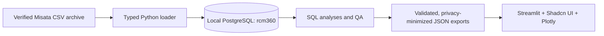

# RCM360

**Healthcare Revenue Cycle Analytics & Data Quality Intelligence**

RCM360 is an analytical portfolio project built from one historical, fully synthetic healthcare dataset. It demonstrates relational modeling, source verification, claim-grain SQL analysis, financial field reconciliation, data-quality controls, and an interactive Streamlit dashboard. It is not a production billing system and contains no live patient or payer data.

> **Verification status:** the PostgreSQL schema, snapshot loader, 28-query analysis pack, exporter, and five-page dashboard are implemented. PostgreSQL has not yet been installed or run in this environment, so the SQL pack has not been executed against a server and PostgreSQL-reconciled JSON exports are not available. The dashboard reports that exports are missing instead of showing sample business metrics.

## At a glance

- Source: [Misata Hospital Encounters, Diagnoses and Claims](https://www.misata.studio/datasets/hospital-encounters-claims), a CC0 synthetic dataset.
- Verified locally: 39,946 rows across seven CSV tables; 4,737 claims; seven unique primary keys; 82,311 valid foreign-key references. See the [dataset profile](docs/dataset_profile.md).
- Database schema: seven PostgreSQL tables, primary and foreign keys, source-supported checks, indexes, an ER diagram, and a claim-grain analytics view.
- SQL: 28 documented analyses, each with a question, output grain, denominator, and interpretation limit. See the [query catalog](sql/queries/README.md).
- Dashboard: five pages for executive overview, claims and denials, revenue and payments, payer and provider comparison, and data quality.
- Design: an indigo interface built with native Streamlit theming, Streamlit Shadcn UI, and Plotly; the source design reference stays local.
- Privacy: the local source includes synthetic identifiers and contact fields. The public dashboard contract omits patient identifiers and attributes.

## Architecture



PostgreSQL is the required execution and reconciliation layer. The dashboard reads the exported JSON files and does not connect to PostgreSQL. Since the data is historical, a hosted database and separate backend are unnecessary. The exporter and QA pipeline are implemented; PostgreSQL execution is required before verified JSON files can be generated.

## Analytical guardrails

- Report claim counts and amounts at one row per claim. Pre-aggregate one-to-many diagnoses, labs, and prescriptions before joining to claim totals.
- `paid_amount` is the source's recorded payer-payment field, not total collections. Patient responsibility is an assigned amount without patient-payment transactions.
- Denial rates are observed status shares with no source observation cutoff or maturity window. Denied billed amounts are gross billed exposure, not confirmed losses or recoverable revenue.
- The data has no remittance or adjustment ledger, appeal/resubmission history, service-line detail, patient-payment transactions, currency field, or collection cutoff. Do not claim aging, outstanding balances, total collections, or collection rates.
- Source patterns describe a synthetic generator, not actual Commure, payer, provider, patient, or clinical behavior. See the [data contract](docs/data_contract.md) and [business questions](docs/business_questions.md).

## Local setup

Use Python 3.11 and a local PostgreSQL server. PostgreSQL is not bundled with the project.

1. Download the archive and verify the pinned SHA-256 using [data/raw/README.md](data/raw/README.md). Keep the ZIP and seven CSV files in `data/raw/`; they are intentionally ignored by Git.
2. Create a virtual environment and install development dependencies:

   ```powershell
   py -3.11 -m venv .venv
   .\.venv\Scripts\python.exe -m pip install -r requirements-dev.txt
   ```

3. Set `DATABASE_URL` in the local PowerShell session to a PostgreSQL URI. Use a local role and password; do not commit `.env` or share credentials in chat.

   ```powershell
   $env:DATABASE_URL = "postgresql://<local-user>:<local-password>@localhost:5432/rcm360"
   ```

4. From the repository root, load the approved source snapshot. The loader creates the `rcm360` schema and source tables in the selected database, loads empty tables, and accepts already-populated tables only when they exactly match the approved snapshot.

   ```powershell
   .\.venv\Scripts\python.exe -m src.etl.load_postgres
   ```

5. After loading, run the read-only SQL analysis pack with `psql` as described in the [query catalog](sql/queries/README.md). Review every reconciliation result before interpreting findings.
6. Generate the validated JSON exports, then start the dashboard:

   ```powershell
   .\.venv\Scripts\python.exe -m src.exports.dashboard_json
   .\.venv\Scripts\python.exe -m streamlit run dashboard/app.py
   ```

The dashboard entry point is `dashboard/app.py`. The checked-in app intentionally requires PostgreSQL-reconciled `dashboard/data/claims.json` and `dashboard/data/quality.json` before it displays analytical results.

## Tests

Run the data tests and dashboard tests from the project root:

```powershell
.\.venv\Scripts\python.exe -B -m unittest discover -s tests/data -v
.\.venv\Scripts\python.exe -m pytest tests/dashboard -q
```

Dashboard tests use isolated contract fixtures and do not represent project findings. Live database, export-reconciliation, and full dashboard visual checks must be run after PostgreSQL is available.

## Project documents

- [Dataset profile](docs/dataset_profile.md) and [data contract](docs/data_contract.md)
- [Business questions](docs/business_questions.md)
- [SQL analysis catalog](sql/queries/README.md) and [quality rules](sql/quality_checks/README.md)
- [Source download and provenance instructions](data/raw/README.md)

Deployment to Streamlit Community Cloud is intentionally not part of the current work. The project should not be described as PostgreSQL-verified or deployment-ready until the corresponding checks have actually passed.
