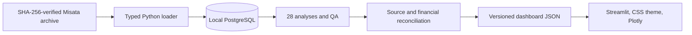
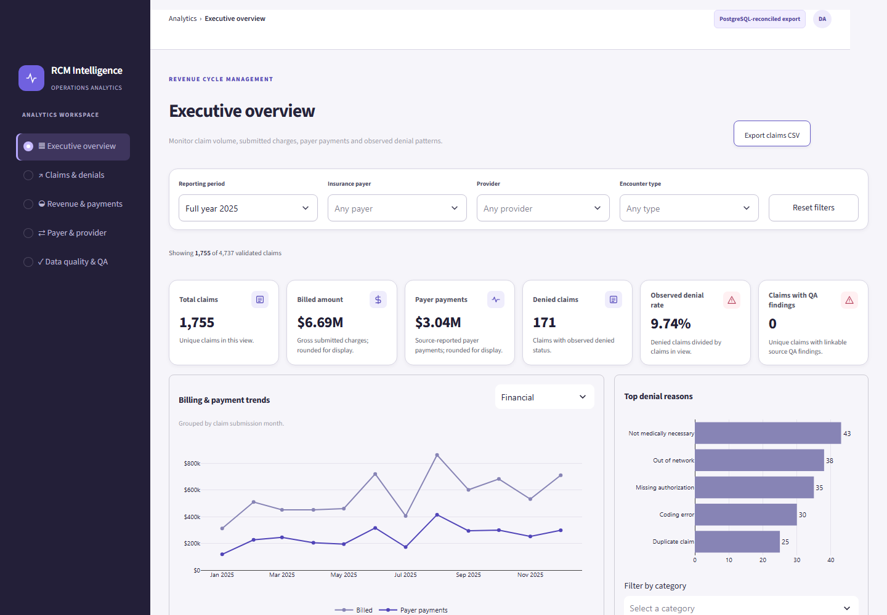

# RCM360

**Healthcare Revenue Cycle Analytics & Data Quality Intelligence**

RCM360 is a reproducible analytics portfolio project using the single, fully synthetic [Misata Hospital Encounters, Diagnoses and Claims dataset](https://www.misata.studio/datasets/hospital-encounters-claims). It examines claim status, denial patterns, financial source fields, payer/provider cohorts, and relational data quality through Python, PostgreSQL, SQL, and an interactive Streamlit dashboard.

This is an analytical demonstration, not a billing system. It contains no real patient or payer records. Source patterns describe a synthetic generator and must not be interpreted as real-world performance.

> **Verification status (2026-11-27):** the generated JSON pair passes the export parsers, provenance checks, and source-level reconciliation. All 4,737 claim rows match the pinned CSV snapshot; exact decimal totals match the documented source baseline. The local full QA report matches the exported public projection: 39,946 source rows, 32/32 original rules passed with zero findings, and 64/64 injected findings detected across 32/32 test rules. Both exports report `reconciled_with_postgres=true`. This review could not directly authenticate to the local PostgreSQL service, so it did not independently rerun the 28-query pack or confirm query-by-query results. The validated, privacy-minimized exports are included in the repository. They contain no direct patient identifiers; the records are synthetic and CC0.

## Project objectives

- Verify the source archive, table grains, keys, relationships, missingness, and financial semantics.
- Build a typed and repeatable load into a locally run PostgreSQL schema.
- Analyze claims and their one-to-many clinical context without duplicating claim counts or amounts.
- Implement read-only SQL analyses and separate original-data QA from deliberately injected test defects.
- Reconcile PostgreSQL results to the pinned source, then export versioned, privacy-minimized JSON.
- Present verified results through a five-page interactive dashboard with filters, drilldown, and CSV export.

## Architecture



The dashboard reads validated JSON files and never connects to PostgreSQL. PostgreSQL remains the required execution and reconciliation layer for final findings and exports. The source archive and extracted CSVs are kept locally and excluded from Git.

## Source-profile checkpoint

These figures were independently profiled from the pinned CSV source using Python and exact `Decimal` arithmetic. The generated claim export matches all source rows and these exact totals. Its metadata reports PostgreSQL reconciliation; direct database query results were not independently rechecked in this review.

| Measure | Source-profile value |
| --- | ---: |
| Rows across seven tables | 39,946 |
| Claims | 4,737 |
| Paid / denied / pending claims | 4,122 / 426 / 189 |
| Observed denied share | 8.99% (426 / 4,737) |
| Billed amount | 18,033,949.84 |
| Allowed amount | 9,172,905.62 |
| Recorded payer payments | 7,938,924.10 |
| Patient responsibility assigned | 7,779,126.53 |
| Billed amount on denied claims | 1,495,593.80 |

The largest recorded denial-reason labels are `not_medically_necessary` (123), `missing_authorization` (96), and `out_of_network` (88). These source labels do not prove root cause. Denied billed amount is descriptive exposure, not confirmed loss or recoverable revenue.

Interpretation limits:

- The snapshot has no observation cutoff or maturity window, so monthly denial shares are observed status proportions, not mature cohort outcomes.
- `paid_amount` is the publisher's payer-payment field. It includes 606,755.02 recorded under `self_pay` in this synthetic source.
- Patient responsibility is an assigned amount; the dataset has no patient-payment transactions, remittance ledger, or adjustment history.
- There is no currency field. Do not infer total collections, collection rates, aging, overdue balances, or denial recovery.
- Diagnoses, labs, and prescriptions are one-to-many encounter tables. Aggregate them before joining to claim-level financial measures.

See the [dataset profile](docs/dataset_profile.md), [data contract](docs/data_contract.md), and [business questions](docs/business_questions.md) for provenance, definitions, and limits.

## Dashboard

Five pages follow the supplied indigo reference structure: executive overview, claims and denials, revenue and payments, payer and provider comparisons, and data quality/QA. Shared filters cover reporting period, payer, provider, and encounter type; the investigation table adds status, search, sorting, pagination, claim detail, drilldown, and filtered CSV export. QA findings remain separate from injected-error test evidence. Financial fields keep their source meanings, and small payer/provider cohorts are flagged.

The UI uses an indigo palette aligned with the local design reference. The reference assets remain local and are not part of the public repository. The Executive Overview was visually reviewed at 1440×1000, 1024×900, and 390×844. Its six KPI cards reflow from six columns on wide desktop to three on tablet and two on phone. Filters have visible borders and keyboard focus, the CSV action uses a high-contrast indigo treatment, and chart labels use darker text.

**Executive Overview screenshot:**



## Technology stack

| Area | Tools |
| --- | --- |
| Data and ETL | Python 3.11, Pandas, NumPy |
| Relational analysis | PostgreSQL, SQL, SQLAlchemy, Psycopg |
| QA and reconciliation | PostgreSQL temporary-table audits, deterministic injected cases, exact Python `Decimal` checks |
| Dashboard | Streamlit, CSS, Plotly, JSON |
| Exploratory analysis | Jupyter, Matplotlib, Seaborn |
| Tests and SQL parsing | Pytest, Pglast |

## Repository map

```text
dashboard/       Five-page Streamlit app and JSON contract
docs/            Data profile, business questions, and data contract
notebooks/       Aggregate-only source EDA notebook
sql/             PostgreSQL schema, view, 28 queries, and QA rules
src/             Verified loader, source audit, and JSON exporter
tests/            Data, QA, exporter, and dashboard tests
```

Raw CSVs, local audit reports, credentials, the HTML design reference, and internal planning files remain outside the public Git tree.

## Run locally

Use Python 3.11 and a local PostgreSQL server. The source ZIP and its seven CSV members must be in `data/raw/`; verify the pinned hash and placement using [data/raw/README.md](data/raw/README.md). The raw inputs are ignored by Git.

```powershell
py -3.11 -m venv .venv
.\.venv\Scripts\python.exe -m pip install -r requirements-dev.txt
```

Set `DATABASE_URL` only in the local PowerShell session. Use a local database role; do not commit `.env` or paste credentials into chat.

```powershell
$env:DATABASE_URL = "postgresql://<local-user>:<local-password>@localhost:5432/rcm360"
```

Load and verify the approved snapshot:

```powershell
.\.venv\Scripts\python.exe -m src.etl.load_postgres
```

Run all 28 read-only analyses using the exact commands in the [SQL query catalog](sql/queries/README.md). Review the reconciliation queries before interpreting results. Run the [QA audit](sql/quality_checks/README.md); its full local report is written to ignored `data/processed/quality_audit.json`, while standard output contains the public-safe projection.

Generate dashboard files only after PostgreSQL successfully reconciles every source table and claim-view amount:

```powershell
.\.venv\Scripts\python.exe -m src.exports.dashboard_json
.\.venv\Scripts\python.exe -m streamlit run streamlit_app.py
```

The exporter writes `dashboard/data/claims.json` and `dashboard/data/quality.json`. It checks the archive hash, verifies every PostgreSQL source table against the pinned snapshot, reconciles exact claim counts and amounts, validates the dashboard contract, and keeps injected QA issue details out of public output.

For source EDA, open the [notebook](notebooks/eda.ipynb) after placing the archive and extracted files in `data/raw/`:

```powershell
.\.venv\Scripts\jupyter.exe lab notebooks/eda.ipynb
```

The notebook rechecks the archive and extracted-member bytes. It displays aggregate summaries and plots, not row-level records or identifier values; committed notebook outputs are cleared.

## Tests

Run the complete local test suite from the repository root:

```powershell
.\.venv\Scripts\python.exe -m pytest -q
.\.venv\Scripts\python.exe -m pip check
```

Current result: **47 tests and 48 subtests passed**; `pip check` reported no broken requirements. The data/export and dashboard tests use isolated contracts and fixtures. SQL grammar parsing does not execute queries. Passing local tests therefore does not establish database query execution. The populated dashboard was inspected locally at desktop, tablet, and phone widths; the Executive Overview's KPI layout and filter focus states were checked in a browser.

## Deployment status

The repository has the root `requirements.txt`, root `.streamlit/config.toml`, root entrypoint `streamlit_app.py`, and validated exports required by Streamlit Community Cloud. The dashboard implementation remains in `dashboard/app.py`. No credentials or direct patient identifiers are included in the published files.

Pushing to the GitHub branch connected to the existing Community Cloud app can trigger an app update. Check the Streamlit deployment status after the repository push. See the [official deploy guide](https://docs.streamlit.io/deploy/streamlit-community-cloud/deploy-your-app/deploy) and [dependency guide](https://docs.streamlit.io/deploy/streamlit-community-cloud/deploy-your-app/app-dependencies).

## Project references

- [Dataset provenance and profile](docs/dataset_profile.md)
- [Data and dashboard contract](docs/data_contract.md)
- [Business questions](docs/business_questions.md)
- [SQL query catalog](sql/queries/README.md)
- [QA rules and audit method](sql/quality_checks/README.md)
- [Entity relationship diagram](sql/schema/erd.md)
