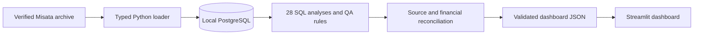

# RCM360

**An auditable healthcare revenue cycle analytics and data quality project.**

[](https://www.python.org/)
[](https://www.postgresql.org/)
[](https://www.misata.studio/datasets/hospital-encounters-claims)

### [**Open the current RCM360 dashboard**](https://rcm360-healthcare-analytics.streamlit.app/)

> **Dataset:** Misata Hospital Encounters, Diagnoses and Claims. The source is fully synthetic; the project contains no real patient or payer records.

## Overview

RCM360 examines claim status, denial patterns, source-reported financial fields, payer/provider cohorts, and relational data quality. It uses Python for loading and exports, PostgreSQL for relational analysis and reconciliation, and Streamlit for an interactive dashboard.

> [!TIP]
> **What I learned:** I learned to protect claim-level measures from one-to-many join inflation, keep payer payments separate from assigned patient responsibility, and trace dashboard KPIs back to SQL and validated exports.

## Explore the dashboard

| Page | What it shows |
| --- | --- |
| **Executive Overview** | Claim volume, billed amount, payer payments, observed denials, and linked QA findings. |
| **Claims & denials** | Denial reasons, status patterns, submission cohorts, and claim-level investigation. |
| **Revenue & payments** | Source-reported financial amounts, reconciliation, and payer payment timing. |
| **Payer & provider** | Cohort comparisons with explicit denial numerators, denominators, and small-sample cautions. |
| **Data quality & QA** | Original-source checks and separate injected-defect test evidence. |

Shared filters cover reporting period, payer, provider, and encounter type. The claim investigation view supports search, sorting, pagination, drilldown, and filtered CSV export.

**Executive Overview screenshot:**


## Data coverage and verification

These profile values were computed from the pinned CSV source using Python and exact `Decimal` arithmetic. All 4,737 claim export rows match the pinned source. The source and exported QA evidence includes 32/32 original checks passed with zero findings, plus 64/64 expected injected defects detected across 32 test rules. Export metadata reports PostgreSQL reconciliation; direct database query results were not independently re-run in the latest review.

| Measure | Source-profile value |
| --- | ---: |
| Rows across seven tables | 39,946 |
| Claims | 4,737 |
| Paid / denied / pending claims | 4,122 / 426 / 189 |
| Observed denied share | 8.99% (426 / 4,737) |
| Billed amount | 18,033,949.84 |
| Allowed amount | 9,172,905.62 |
| Recorded payer payments | 7,938,924.10 |
| Assigned patient responsibility | 7,779,126.53 |
| Billed amount on denied claims | 1,495,593.80 |

The most frequent recorded denial reasons are `not_medically_necessary` (123), `missing_authorization` (96), and `out_of_network` (88). These are source labels, not verified root causes. Denied billed amount is descriptive exposure, not confirmed loss or recoverable revenue.

Interpretation limits:

- The snapshot has no observation cutoff or maturity window. Monthly denial shares describe observed status by submission cohort, not mature cohort outcomes.
- `paid_amount` is the source's payer-payment field. It includes 606,755.02 recorded under the `self_pay` label in this synthetic dataset.
- Patient responsibility is an assigned amount; there are no patient-payment transactions, remittance ledger, or adjustment history.
- The source has no currency field. Do not infer total collections, collection rates, aging, overdue balances, or denial recovery.
- Diagnoses, labs, and prescriptions are one-to-many encounter tables. Aggregate these before joining to claim-level financial measures.

See the [dataset profile](docs/dataset_profile.md), [data contract](docs/data_contract.md), and [business questions](docs/business_questions.md) for provenance, definitions, and limitations.

## Engineering highlights

- **Reproducible source checks:** the loader verifies the pinned source archive and its table structure before importing.
- **Relational analysis:** PostgreSQL schema and views retain explicit table grains; the repository includes the existing 28 SQL queries.
- **Financial reconciliation:** exact decimal checks protect claim counts and source financial totals from join multiplication or rounding drift.
- **Separate QA evidence:** original-source findings are distinct from deliberately injected test defects.
- **Privacy-minimized exports:** the dashboard reads validated JSON and does not connect to PostgreSQL. Public claim exports omit direct patient identifiers and injected issue details.
- **Analytical context:** payer payment timing reports discrete P50/P90 for paid claims with recorded durations. Denial rates show their numerator and denominator. Neither is presented as a broader outcome than the source supports.
- **Consistent dashboard KPIs:** automated tests compare committed JSON exports with the production Executive Overview KPI calculations.

### Architecture



## KPI definitions and SQL crosswalk

| Dashboard measure | Definition | SQL or evidence |
| --- | --- | --- |
| Total claims | Unique `claim_id` rows in the filtered cohort | Q03; Q26 reconciliation |
| Billed amount | Sum of source `billed_amount` | Q11; Q26 reconciliation |
| Payer payments | Sum of source `paid_amount`; not total collections | Q11; Q26 reconciliation |
| Denied claims | Claim rows with observed `status = 'denied'` | Q03; Q04 payer groups; Q05 provider groups |
| Observed denial rate | Denied claims divided by all claims in the cohort | Q03–Q05; Q28 by submission month |
| Denial reason frequency | Denied claims with a recorded reason; no root cause is inferred | Q07; Q08 |
| P50/P90 payment timing | Discrete percentiles of recorded `submission_to_payment_days` for paid claims, by payer | Q17 |
| Claims with QA findings | Unique filtered claim IDs with linkable original-source QA issues; injected test issues excluded | `quality.json` original section and data contract |

Payment percentiles use PostgreSQL `percentile_disc` semantics: they select observed values and do not interpolate. The results describe the paid subset, not cohort-wide turnaround or claim aging.

## Technology stack

| Area | Technologies |
| --- | --- |
| Data loading and exports | Python 3.11, Pandas, NumPy |
| Relational analysis | PostgreSQL, SQL, SQLAlchemy, Psycopg |
| QA and reconciliation | PostgreSQL checks, deterministic injected cases, Python `Decimal` |
| Dashboard | Streamlit, CSS, Plotly, JSON |
| Exploratory analysis | Jupyter, Matplotlib, Seaborn |
| Tests and SQL parsing | Pytest, Pglast |

## Run locally

### Open the populated dashboard

The committed, validated JSON exports let you run the dashboard without a database connection.

```powershell
git clone https://github.com/emam26/RCM360-Healthcare-Analytics.git
cd RCM360-Healthcare-Analytics

py -3.11 -m venv .venv
.\.venv\Scripts\python.exe -m pip install -r requirements.txt
.\.venv\Scripts\python.exe -m streamlit run streamlit_app.py
```

Streamlit prints the local URL after startup.

### Rebuild the data and exports

For the full data workflow, use a local PostgreSQL installation and the approved source archive. Place the source ZIP and its seven CSV members in `data/raw/`; see the [raw-data instructions](data/raw/README.md) for the pinned hash and placement rules. Raw inputs and database credentials are excluded from Git.

Set `DATABASE_URL` in your local PowerShell session. Never commit `.env` files or share database credentials.

```powershell
$env:DATABASE_URL = "postgresql://<local-user>:<local-password>@localhost:5432/rcm360"
```

Load the source tables and execute the analyses using the [SQL query catalog](sql/queries/README.md):

```powershell
.\.venv\Scripts\python.exe -m src.etl.load_postgres
```

Run the [QA audit](sql/quality_checks/README.md), review the reconciliation queries, and generate exports only after PostgreSQL and source totals reconcile:

```powershell
.\.venv\Scripts\python.exe -m src.exports.dashboard_json
```

The exporter validates the archive hash, source-table counts and claim totals against the database, checks the dashboard contract, and excludes injected QA issue details from public output.

## Validation

```powershell
.\.venv\Scripts\python.exe -m pytest -q
.\.venv\Scripts\python.exe -m pip check
```

Latest local result: **51 tests and 48 subtests passed**; `pip check` reported no broken requirements. The suite includes committed-export KPI consistency and discrete-percentile checks. The SQL parser accepted all 28 statements; parsing does not execute the queries. The latest review could not independently connect to local PostgreSQL, so query-by-query database execution is not claimed here.

The populated Executive Overview and Revenue & Payments pages were visually inspected locally. The screenshot above is stored in `docs/images/`; the source HTML design reference is maintained locally and is not included in this public repository.

## Repository map

| Path | Purpose |
| --- | --- |
| `dashboard/` | Five-page Streamlit app, validated JSON exports, and dashboard contract |
| `docs/` | Dataset profile, business questions, and data contract |
| `notebooks/` | Aggregate-only exploratory analysis |
| `sql/` | PostgreSQL schema, views, 28 queries, and QA rules |
| `src/` | Source verification, loader, audits, and JSON exporter |
| `tests/` | Data, export, QA, and dashboard tests |

Raw source files, local audit reports, credentials, the HTML design reference, and internal planning files are not included in the public Git tree.

## Deployment status and limitations

The repository includes the root Streamlit entrypoint, dependency files, configuration, and validated exports needed for Streamlit Community Cloud. The app reads JSON exports and does not require database credentials at runtime. A push to a connected GitHub branch may trigger a Community Cloud update; hosted deployment status was not independently verified during the latest review.

The project is a focused analytics portfolio, not a production billing application. PostgreSQL remains the required source of query execution and reconciliation evidence; the dashboard is a read-only presentation of validated exports.

## Project references

- [Dataset provenance and profile](docs/dataset_profile.md)
- [Data and dashboard contract](docs/data_contract.md)
- [Business questions](docs/business_questions.md)
- [SQL query catalog](sql/queries/README.md)
- [QA rules and audit method](sql/quality_checks/README.md)
- [Entity relationship diagram](sql/schema/erd.md)
